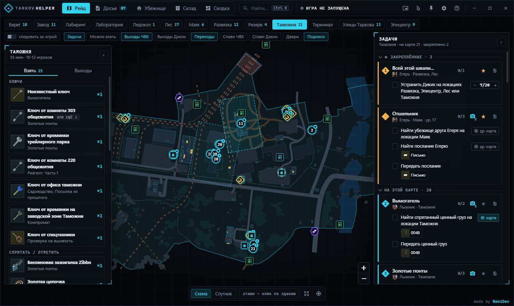
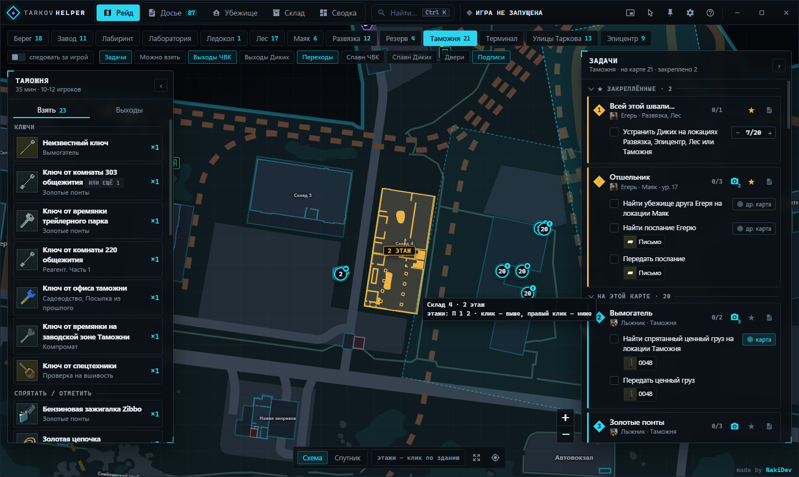
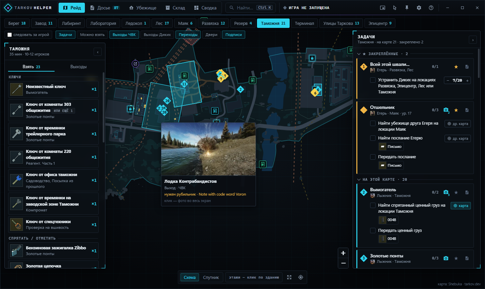
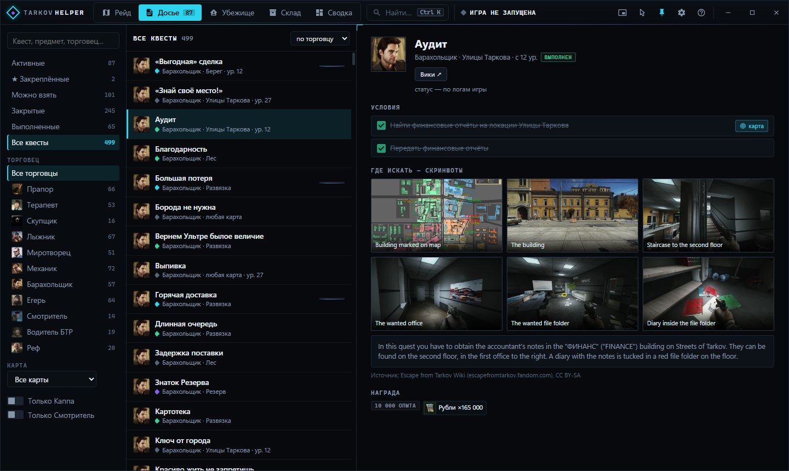
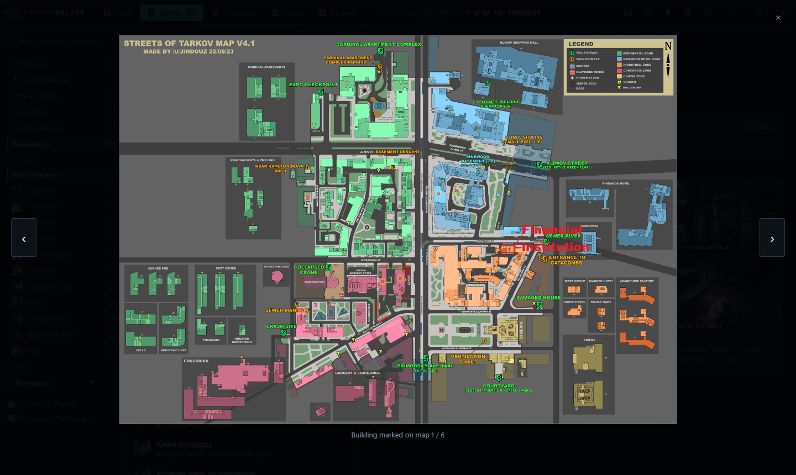
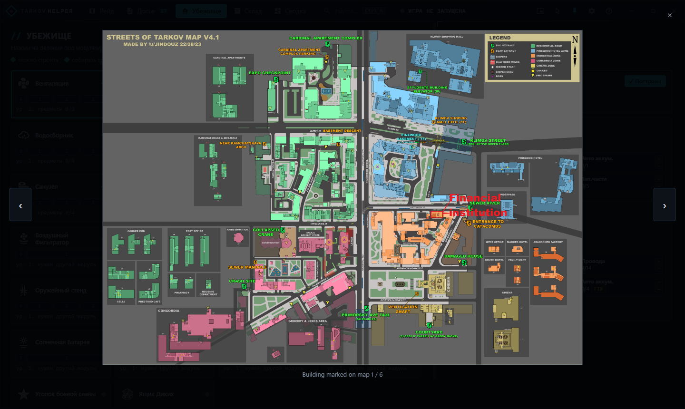
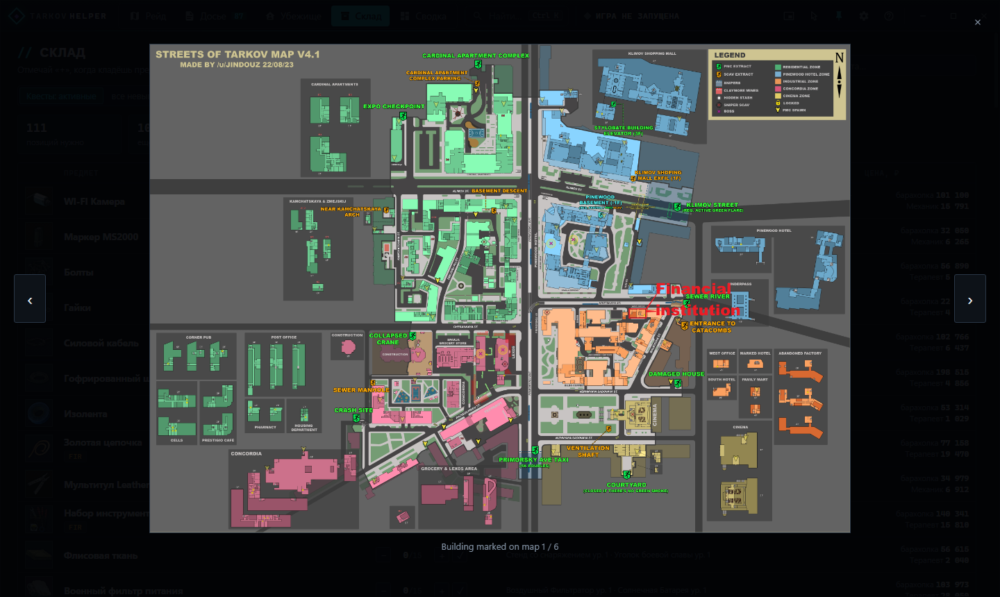
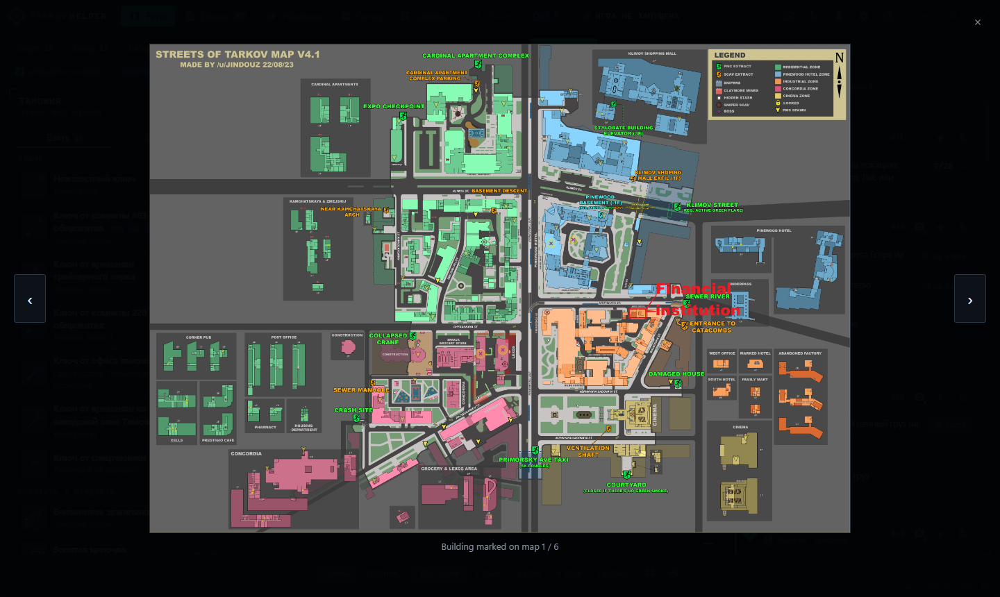
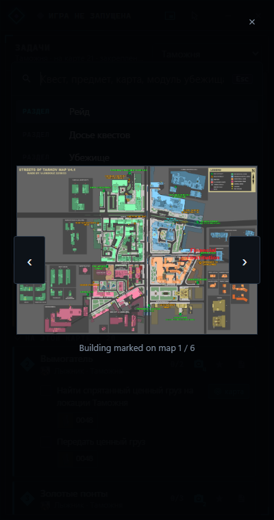

# Tarkov Helper

Помощник для **Escape from Tarkov**. Отдельное окно поверх игры показывает карту с точками заданий, квесты, скриншоты нужных мест, убежище и предметы, которые нужно собрать.

Всё работает **только по текстовым логам игры**. Процесс игры приложение не трогает: память не читает, код не внедряет, трафик не перехватывает. Поэтому оно безопасно с BattlEye.



## Возможности

- **Рейд.** Карта на весь экран с точками активных заданий, выходами ЧВК и Диких, переходами и дверями, к которым нужен ключ. Сверху полоса карт: на каждой отмечено число активных квестов, а метка `LIVE` стоит на карте, которая сейчас загружена в игре. Когда игра загружает локацию, карта переключается сама.
- **Своя векторная карта.** Карты лежат внутри приложения и правятся как обычные файлы: геометрия в `assets/maps/*.svg`, цвета и обводки в `src/renderer/map-theme.css`, русские подписи зданий и улиц в `assets/map-labels-ru.json` (Fortress → Крепость). Как редактировать — в `assets/maps/README.md`. Для Лабиринта и Ледокола открытых векторных карт нет, там затемнённые плитки tarkov.dev в той же гамме.
- **Этажи — клик по зданию.** Здания находятся по геометрии этажей, контур при наведении повторяет настоящую форму здания (и повёрнутые тоже). Клик — этаж выше, правый клик — ниже. На здании появляется плашка «2 этаж», всё под выбранным этажом затемняется, а сам этаж подсвечивается своим оттенком. Метки с других этажей приглушаются.
- **Спавны ЧВК и Диких.** Сторона рейда берётся из логов (у Дикого между загрузкой и стартом рейда нет отсчёта, в группе сторона записана прямо в настройках рейда). Если включено «следовать за игрой», для Дикого сами включаются выходы и спавны Диких, для ЧВК — ЧВК.
- **Метки заданий.** Круг с номером квеста и значком типа условия (найти, отметить, заложить, убить, посетить). Зона, где засчитывается условие, — тонкий пунктир. Переходы — фиолетовый шестиугольник со стрелками.
- **Выходы и переходы — иконками.** При наведении появляется карточка: фото выхода с вики, фракция, требования («нужен рубильник», «сигнальная ракета», «оплата») и примечания. Клик — фото во весь экран.
- **Брифинг.** Что взять с собой на эту карту: ключи, маркеры, предметы для закладок, нужное оружие и снаряжение, предметы FiR для сдачи.
- **Задачи.** Квесты на текущей карте, номера совпадают с метками на карте. Наведёшь на квест — его точки подсветятся. ★ закрепляет квест наверху.
- **Счётчики «2 из 5»** у условий с количеством. Игра пишет в логи только «квест взят / выполнен», поэтому промежуточный прогресс отмечаешь сам кнопкой «+».
- **Фото мест с вики.** Только скриншоты самого места или предмета: где лежит лут, нужная дверь, полка. Карты с обводкой отбрасываются — точка уже стоит на нашей карте. Наведи на метку задания или значок камеры — превью, клик — галерея.
- **Досье.** Все квесты с фильтрами по статусу, торговцу и карте, Каппе и Смотрителю, а также цепочка «после / открывает» и награды.
- **Убежище.** Уровни модулей и требования к следующему: предметы, другие модули, торговцы, умения.
- **Склад.** Все нужные предметы для квестов и убежища: сколько собрано, для чего нужны, цены и сколько стоит докупить всё на барахолке.
- **Сводка.** Прогресс, торговцы, журнал событий из логов. Вайп определяется автоматически.
- **Компактный режим.** Узкая панель с задачами поверх игры.
- **Сквозь окно (Alt+Z).** Клики уходят в игру, но верхняя панель остаётся кликабельной: режим можно выключить мышкой.
- **Настройки.** Обновить базу квестов (новые квесты появятся, удалённые исчезнут; та же кнопка есть в досье), обновить фото с вики, пересканировать логи и сбросить статистику профиля.
- **Поиск Ctrl+K** по квестам, предметам, картам и модулям.

| Этажи кликом по зданию | Выход: фото и требования |
|---|---|
|  |  |

| Досье и фото места | Галерея |
|---|---|
|  |  |

| Убежище | Склад |
|---|---|
|  |  |

| Поиск Ctrl+K | Компактный режим |
|---|---|
|  |  |

## Установка

1. Скачай `TarkovHelper-Setup-*.exe` из [Releases](../../releases). Есть и `TarkovHelper-Portable-*.exe`, он работает без установки.
2. В игре включи **Настройки → Графика → «Оконный без рамки»**. Иначе окно не будет видно поверх игры.
3. Запусти Tarkov Helper. Папка логов находится сама (Steam и лаунчер BSG). Если не нашлась, укажи её в настройках: `…\Escape from Tarkov\build\Logs`.

Установщик не подписан цифровой подписью, поэтому Windows SmartScreen может предупредить. Нажми «Подробнее → Выполнить в любом случае».

### Горячие клавиши (по умолчанию)

| Клавиши | Действие |
|---|---|
| `Alt+X` | показать / скрыть окно |
| `Alt+Z` | «сквозь окно»: клики проходят в игру |
| `Alt+C` | компактная панель задач |
| `Alt+M` / `Alt+Q` | карта / досье |
| `Ctrl+K` | поиск по всему |
| `Ctrl+1…5` | разделы |

## Нагрузка на ПК

По умолчанию включён **экономный режим**: приложение не использует видеокарту (она вся достаётся игре), сетевая служба работает внутри основного процесса, а скрытое окно не рисуется и через минуту выгружает карту из памяти. Когда игра закрыта, логи проверяются реже.

Замер в простое, Windows 11, реальный профиль:

| | без экономного режима | экономный режим |
|---|---|---|
| Процессов | 4 | 3 |
| Память (рабочий набор) | ~437 МБ | ~310–370 МБ |
| Личная память | ~353 МБ | ~170–190 МБ |
| Процессор в простое | ~0,5% ядра | ~0–0,2% ядра |
| Установщик / на диске | — | 88 МБ / 286 МБ |

## Откуда берутся данные

| Источник | Что берётся |
|---|---|
| Логи игры (`build\Logs`, только чтение) | режим PvE/PvP, профиль, загрузка карты, начало и конец рейда, сторона (ЧВК / Дикий), квесты: взят / выполнен / провален |
| [tarkov.dev](https://tarkov.dev) (`json.tarkov.dev`) | квесты, карты, выходы, убежище, торговцы, цены |
| [Escape from Tarkov Wiki](https://escapefromtarkov.fandom.com) | фото мест и гайд из раздела Guide страницы квеста; фото выходов и переходов, требования к ним — со страницы карты; кэш на 2 недели |
| Имена файлов скриншотов (по желанию, выключено) | координаты игрока, их пишет сама игра |

**Чего нет в логах:** уровня персонажа (приложение оценивает его по взятым квестам, можно указать вручную), уровней убежища, прогресса подзадач и ежедневных/еженедельных заданий.

## Сборка из исходников

```bash
npm install
npm start            # запуск
npm run dist         # установщик и переносная версия в release/
```

Код:
- `src/main/` — основной процесс: чтение логов (`logwatcher.js`, `logparser.js`), прогресс (`progress.js`), данные tarkov.dev (`tarkovdata.js`), вики (`wiki.js`);
- `src/renderer/` — интерфейс: `app.js`, `store.js`, `map.js` на Leaflet, `ui.css`, тема карты `map-theme.css`;
- `assets/maps/` — векторные карты, `assets/map-labels-ru.json` — русские подписи.

Автор — [NakiDev](https://github.com/Naki-404).

## Лицензии

- Код проекта — MIT, см. [LICENSE](LICENSE).
- Расчёт координат карт и `assets/mapdefs.json` взяты из [tarkov-dev](https://github.com/the-hideout/tarkov-dev) (MIT, см. `assets/LICENSE-tarkov-dev.txt`). SVG-карты в `assets/maps/` основаны на [tarkov-dev-svg-maps](https://github.com/the-hideout/tarkov-dev-svg-maps) (CC BY-NC-SA 4.0, только некоммерческое использование, см. `assets/maps/LICENSE-CC-BY-NC-SA-4.0.md`).
- Скриншоты и тексты гайдов принадлежат авторам Escape from Tarkov Wiki (CC BY-SA). Приложение показывает их со ссылкой на источник.
- Escape from Tarkov — товарный знак Battlestate Games. Проект неофициальный и с BSG не связан.
